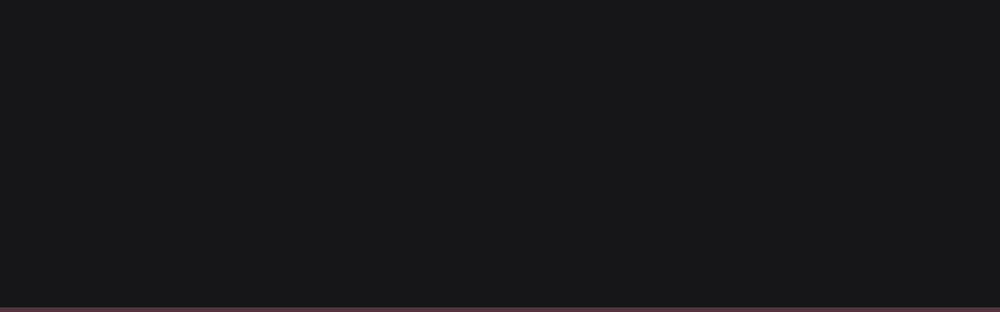

<p align="center">
  
</p>

<h1 align="center">jhon-studio — presentation videos for any project</h1>

<p align="center">
  <b>Narrated presentation videos of any project, made by code.</b><br>
  Its own name, palette, logo and screens; spoken in English or Spanish, subtitled in the other.
</p>

<p align="center">
  <a href="LICENSE"></a>
  <a href="https://github.com/jachavarro2004/jhon-studio/releases"></a>
  <a href="https://github.com/jachavarro2004/jhon-studio/actions/workflows/ci.yml"></a>
  <a href="https://github.com/sponsors/jachavarro2004"></a>
  <a href="https://github.com/jachavarro2004/jhon-studio/stargazers"></a>
</p>

Narrated presentation videos for any project, made by code: the project's own name, palette,
logo and screens; a flat animated intro; real screens held close as proof (images, command
output, web pages); narration spoken locally by Kokoro in English or Spanish, subtitled in the
other; rendered to MP4 by
[HyperFrames](https://github.com/heygen-com/hyperframes) on the studio's own motion engine.

It works on its own, in any project folder. It is also an opt-in integration of
[Jhon](https://github.com/jachavarro2004/jhon-agent): with the integration on, Jhon runs it
through `/jhon:video` ([With Jhon](#with-jhon)); with it off, Jhon shows and loads nothing
about video.

Status: version 0.1.0, the first release ([Releases](#releases)). The whole flow works on any
project (a web app, a command-line tool, a library): a brief drafted from its own text, a script
written from it (by you or an agent) and approved, its screens captured, the narration spoken,
the MP4s rendered.

## Install

Needs Node 22 or newer (it runs the TypeScript sources with Node's type stripping: no build step,
no dependencies), ffmpeg, and for narration and renders Kokoro and the HyperFrames CLI; web
screens are captured with the chrome-headless-shell HyperFrames keeps (`jhon-studio doctor` says
what is missing and how to add it; it starts that Chrome for real).

Install the latest release, 0.1.0: download its tarball, check its sha256 and its signature
(with [cosign](https://docs.sigstore.dev/cosign/system_config/installation/): the release
workflow of this repository signed it at its tag), unpack it into a folder of its own version and
link the command onto PATH:

```sh
V=0.1.0
R=https://github.com/jachavarro2004/jhon-studio/releases/download/v$V
T=jhon-studio-$V.tar.gz
cd "$(mktemp -d)"
curl -fsSLO "$R/$T" -O "$R/$T.sha256" -O "$R/$T.sigstore.json"
sha256sum -c "$T.sha256"
cosign verify-blob --bundle "$T.sigstore.json" \
  --certificate-identity "https://github.com/jachavarro2004/jhon-studio/.github/workflows/release.yml@refs/tags/v$V" \
  --certificate-oidc-issuer https://token.actions.githubusercontent.com "$T"
mkdir -p ~/.local/share/jhon-studio/$V ~/.local/bin
tar -xzf "$T" -C ~/.local/share/jhon-studio/$V
ln -sfn ~/.local/share/jhon-studio/$V/bin/jhon-studio ~/.local/bin/jhon-studio
jhon-studio doctor
```

Stop at the first line that fails: `sha256sum -c` and `cosign verify-blob` exit non-zero on a
tarball that is not the one released (on macOS, `shasum -a 256 -c` instead of `sha256sum -c`).
Any folder on PATH does instead of `~/.local/bin`: the link is followed to the version's folder,
where the studio finds its templates, fonts and agent plugin. `jhon-studio --version` prints the
version. To update, run the same lines with the newer version: it unpacks beside the older one,
and the link moves to it; linking the older folder again rolls back. (An install from before the
releases, a clone in `~/.local/share/jhon-studio`: move it away first.) To work on the studio
itself, use a clone instead ([Development](#development)).

## With Jhon

The studio is an opt-in integration of Jhon, off by default: with it off, Jhon shows and loads
nothing about video. Turn it on with `jhon setup` (choose jhon-studio) or the setting
`integrations.studio = true`. Then:

- in pi, `/jhon:video` makes a video of the project you are in;
- in Claude Code, the studio's own plugin (`plugin/claude-code`, loaded by Jhon with a second
  `--plugin-dir`) adds `/jhon-studio:video`: Claude Code names a plugin's skills
  `<plugin>:<skill>`.

Both run the same skill ([plugin/claude-code/skills/video/SKILL.md](plugin/claude-code/skills/video/SKILL.md)):
`jhon-studio doctor`, `init` (and what to change in it), `video brief`, the script drafted from
it and checked, `video make` to a preview, `video review` (the contact sheet, shown to you with
the script), your approval (the agent never approves for you), then the MP4s. Jhon's `jhon doctor` checks the studio through `jhon-studio doctor --json`, and
finds the plugin and the skill with `jhon-studio integration --json`:

```json
{ "schema": "jhon-studio.integration/v1", "version": "0.1.0", "requires_jhon": ">=0.5.0-rc.1", "contract": "jhon.integration/v1",
  "plugin_dir": "/…/jhon-studio/0.1.0/plugin/claude-code", "skill": "/…/jhon-studio/0.1.0/plugin/claude-code/skills/video/SKILL.md" }
```

`schema` is this answer's own format; `requires_jhon` the jhon versions the studio runs with (a
SemVer range); `contract` the integration contract it speaks. A jhon outside the range turns the
studio off for its run with one note, and works as it does with the studio off
([Releases](#releases)).

Without Jhon, the plugin works on its own: `claude --plugin-dir ~/.local/share/jhon-studio/plugin/claude-code`.

## The flow

A video lives in its project, in `.jhon/studio/<video>/`.

```sh
cd my-project
jhon-studio init                       # .jhon/studio.yaml with guessed defaults; edit it
jhon-studio video brief readme         # .jhon/studio/tour/brief.md: what the video is made from
jhon-studio video script               # the shot model, an example of each kind, the screens, the brief
$EDITOR .jhon/studio/tour/script.json  # write the script (or have an agent write it)
jhon-studio video script --check       # kinds, fields, marks in order, subtitles
jhon-studio video make                 # capture, narrate, compose; stops for the approval (exit 3)
jhon-studio video review               # review.png: each shot's final state, and the shot times
jhon-studio video script --approve     # you read the script, look at the sheet, and approve it
jhon-studio video make                 # renders/tour.mp4 and renders/tour.es.mp4
```

`video make` runs what is left, in order (capture, narrate, compose, render), and stops where
you are needed, with exit 3 and what to do: no `script.json` yet, or a script not approved as
it is now. It composes before it stops, so the video can be previewed (`npx hyperframes
preview` in the video folder) and reviewed (`video review`) before the approval. Each step also
runs alone:

| Step | What it does |
| --- | --- |
| `video brief <source>` | drafts `brief.md` from `readme`, `ldd:<change>` (`openspec/changes/<change>/` or `ldd/changes/<change>/`: proposal, design, tasks), `release:<tag>` (its CHANGELOG section, else `git log <previous tag>..<tag>`) or a file; text extraction only, no model |
| `video script` | prints the shot model, a valid example of each kind in the narration's language, the screens and the brief; `--check` validates; `--approve` stores the script's hash |
| `video capture` | makes the screens `studio.yaml` lists into `screens/` (files, commands, web pages) |
| `video narrate` | speaks each new line with Kokoro into `narration/` (a line is spoken once) |
| `video compose` | writes `index.html` and `captions.<lang>.json`, then measures every shot in a headless Chrome and fails on text that overflows its frame, naming the shot and the element |
| `video review` | captures each shot's final state into `review.png` (a contact sheet) and `review/<shot>.png`, and prints each shot's start and end |
| `video render` | renders the MP4s with HyperFrames; refuses a script not approved as it is now |

The approval is the script's hash (`"approved": { "sha256": ... }`, the SHA-256 of the script
without that field): any change after it, a word or a mark, needs a new approval, and render
says so: "the script changed after its approval: run jhon-studio video script --approve". An
older script's `"approved": true` is read as not approved: "this script's approval predates its
hash: run jhon-studio video script --approve".

`--project <dir>` points at another folder; `--video <id>` names the video when the project
has more than one (`video brief` names it after its source: `tour`, the change, `release-<tag>`,
the file's name); `video render --lang en` renders one language; `--dry-run` (render, make)
prints the HyperFrames commands instead. Every command has `--help`. Exit codes: 0 done, 1
refused or failed, 2 a usage error (or web screens, or `video review`, with no Chrome), 3 `video
make` stopped where you are needed.

### Text that fits its frame

Text wraps (balanced) inside its box instead of running off the picture on one line, and each
element shrinks first, down to a smallest size, before it wraps: a headline's lines (116 px down
to 72, at one size), a card's title (its `size`, 108 px by default, down to 64; one row per
title line before it wraps) and its body lines (48 down to 34), a list's rows (78 down to 48; a
row may take two), the figures (200 down to 96), the close's pitch (down to 56), the intro's
name (down to 72) and tagline (54 down to 36), and the kickers, which keep to one line (down to
18). The fitting runs in the page once its fonts are loaded, before HyperFrames seeks a frame.
Text that cannot fit even so fails `video compose` (and `video make`) with exit 1, every shot at
its final state measured in a headless Chrome:

```
jhon-studio: the text does not fit its frame in 1 shot (index.html is written, to preview it):
  problem: the headline's line 1 (#problem-l1) runs 212 px past the frame's bottom
shorten that text (or split it across shots), then compose again
```

The frame is the card for a card's text, and for every text the picture less 48 px at the sides
and 32 at the top, above the subtitles (y 930). Without a Chrome, compose writes the composition
and says `text fit: not measured: no Chrome (...)`.

### Review before the approval

`jhon-studio video review` captures each shot at its final state (0.35 s before its end, before
the cut or band that leaves it) from the composition, in a headless Chrome that runs in the video
folder and is served that folder alone (never the project's or the caller's folder): one PNG per
shot in `review/` and `review.png`, a contact sheet of all of them, each under its shot's id,
kind, start and end. It prints the times:

```
shot     kind     start     end   frame at
intro    intro     0.00    8.00      7.65
problem  head      8.00   14.95     14.60
...
```

Look at the sheet before the script is approved (an agent shows it to the owner with the script).
It needs the composition as the script is now (`video compose` or `video make` first).

What a video folder holds:

```
.jhon/studio/<video>/
  brief.md             what the script is written from (video brief drafts it; edit it)
  script.json          the source: you write it, and approve it
  screens/             GENERATED by capture, when studio.yaml lists screens
  narration/           <key>.opus and <key>.json per spoken line (cached; a line is spoken once)
  index.html           GENERATED: the HyperFrames composition
  review.png, review/  GENERATED by video review: the contact sheet and each shot's frame
  captions.<lang>.json GENERATED: the subtitles, one file per subtitle language
  assets/              GENERATED: a copy of the studio's fonts and their licence (fonts/, so the
                       folder carries its own); links to the screens and the narration; the logo
  vendor/              GENERATED link to three.js (only for `intro: seal`)
  renders/             the MP4s: <video>.mp4 in the narration's language, <video>.<lang>.mp4 subtitled
```

## From an agent

The studio has no model of its own: the brief is extracted, and the script is written by you or
by an agent (Claude Code, pi; Jhon exposes it as `/jhon:video` when its studio integration is
on, and the skill it runs is [plugin/claude-code/skills/video/SKILL.md](plugin/claude-code/skills/video/SKILL.md)).
An agent's loop:

1. `jhon-studio video brief readme` (or the change, the release, a file the user names), then
   read `brief.md` and correct what the extraction got wrong with the user.
2. `jhon-studio video script`: everything needed to write `script.json` (the kinds, the rules,
   an example, the screens with their sizes, the brief). Write it; `--check` until it is valid.
   Use only what the brief or the project shows: no invented figures.
3. `jhon-studio video make`: exit 3 means the owner must read and approve the script. Exit 1
   with "the text does not fit its frame" names what to shorten.
4. `jhon-studio video review`: look at `review.png` first (text crowded, a mark in the wrong
   place, an empty shot), fix the script and run make and review again; then show the owner the
   script and the sheet, and let the owner run `jhon-studio video script --approve` (an agent
   never approves for them).
5. `jhon-studio video make` again: the MP4s, in `renders/`.

## .jhon/studio.yaml

Every key is optional; a missing one takes its default. The file is a small subset of YAML
(mappings, lists of scalars or of mappings, quoted or plain scalars, comments), read by the studio's own parser; anything
outside the subset is refused with its line number. Quote colours: `"#1a2b3c"`.

| Key | Default | Meaning |
| --- | --- | --- |
| `name` | the README's H1, else the folder's name | the wordmark |
| `tagline` | the first sentence of the README's first paragraph | the intro's and the close's line |
| `url` | the git remote as a web address (only when the project is the repository's root) | shown on the close |
| `palette` | neutral ink: `accent: "#d2d6dc"`, `accent_fill: "#373b41"`, `ink: "#eef0f2"`, `page: "#18191c"` | four colours; every other tone is derived from them |
| `mark` | `glyph:` the name's initial | `glyph: X` (one character, set on a square) or `path: assets/logo.svg` (SVG, PNG, JPEG or WebP) |
| `intro` | `flat` | `flat`: the mark stamps down and the name inks beside it; `seal`: a 3D seal with the glyph (glyph marks only) |
| `narration` | `en` | the language the lines are spoken in: `en` or `es` |
| `subtitles` | the other language | the languages the lines are subtitled in (a render each); `[]` for none |
| `voice` | `af_heart` for `en`, `ef_dora` for `es` | the Kokoro voice of the narration (any in `voices-v1.0.bin`) |
| `screens` | the first of `docs/screens`, `docs/assets`, `screens`, `assets` that exists | the folder a proof's `src` is in, or a list of what `video capture` makes (below) |
| `capture` | `chrome_no_sandbox: false` | `chrome_no_sandbox: true` starts every Chrome the studio starts, and the render's, without Chrome's own sandbox ([Chrome inside a sandbox](#chrome-inside-a-sandbox)) |

`languages: [en, es]`, the older spelling, still reads as the narration's language (`en` unless
`narration` says otherwise) and the others as subtitles.

```yaml
name: Larder
tagline: Cook from what you already have.
url: https://example.com/larder
palette:
  accent: "#7fd1b9"
  accent_fill: "#1f4a40"
  ink: "#eef4f1"
  page: "#141a19"
mark:
  path: assets/logo.svg
narration: en
subtitles: [es]
screens: screens
```

### Screens to capture

`screens` may list the screens instead of naming a folder; `video capture` (and `video make`)
makes them into the video's `screens/`, and a proof's `src` is the name:

```yaml
screens:
  - file: docs/pantry.png            # a PNG or SVG of the project, copied (name: to rename it)
  - cli:                             # a command: plan.svg, a terminal in the project's palette
      command: [larder, plan, --week]  # an argv list, run in the project; never a shell line
      name: plan
      cols: 72                       # the terminal's width (default 100); timeout: 30 (seconds)
  - web:                             # a page in a headless Chrome: list.png
      url: http://localhost:3000/list  # http, https, file, or a path in the project
      name: list
      viewport: [1600, 900]          # the default; scale: 2 for twice the pixels
      steps:                         # run in order before the capture
        - fill: ["#item", "Chickpeas"]
        - click: "#add"
        - wait: ".added"             # a selector to appear, or milliseconds
        - scroll: 400                # pixels, or a selector to scroll to
        - goto: /week                # another address (relative to the page's)
```

A command runs with colour forced on (`FORCE_COLOR`, `CLICOLOR_FORCE`, `COLUMNS`); one that
fails or outlives its timeout is refused with its last lines. Web pages are driven over the
Chrome DevTools Protocol with Node's own WebSocket (no npm dependency, no browser download):
the chrome-headless-shell the HyperFrames CLI keeps (`npx --yes hyperframes@0.9.58 browser
ensure`) or `$JHON_STUDIO_CHROME`; without one, web screens are refused with that fix and
capture exits 2, after making every other screen. The app must be running for an http address.

### Chrome inside a sandbox

Chrome's own sandbox needs user namespaces. Inside a sandbox that allows none (Jhon's, a
container), Chrome dies with "No usable sandbox!", and the studio says so with the fix:

```
jhon-studio: screens[0] (home.png): Chrome could not start its sandbox ("No usable sandbox!"): set capture.chrome_no_sandbox: true in the project's .jhon/studio.yaml (or JHON_STUDIO_CHROME_NO_SANDBOX=1) to start Chrome without its own sandbox, inside a sandbox that allows it none (such as Jhon's)
```

Opt in only there, where the outer sandbox is what confines Chrome:

```yaml
capture:
  chrome_no_sandbox: true   # false by default
```

Every Chrome the studio starts (capture, the text-fit check, review, doctor) then runs with
`--no-sandbox --disable-setuid-sandbox --no-zygote`, and the render tells HyperFrames the same
(`HYPERFRAMES_CHROME_SANDBOX=0`). `JHON_STUDIO_CHROME_NO_SANDBOX=1` (or `0`) overrides the
setting either way.

## script.json

```json
{
  "approved": false,
  "say": { "CLI": "C L I" },
  "shots": [
    { "id": "intro", "kind": "intro", "en": "Larder. Cook from what you already have.", "es": "Larder. Cocina con lo que ya tienes." },
    { "id": "pantry", "kind": "proof", "src": "pantry.png",
      "marks": [{ "at": "what is in stock", "r": [48, 136, 920, 716] }, { "at": "use soon", "r": [1008, 136, 544, 420] }],
      "en": "Larder keeps the list: what is in stock, and what to use soon.",
      "es": "Larder lleva la lista: lo que hay y lo que conviene usar pronto." },
    { "id": "close", "kind": "close", "en": "Larder. Cook from what you already have.", "es": "Larder. Cocina con lo que ya tienes." }
  ]
}
```

Every shot has an `id` (lowercase letters, digits, dashes), a `kind`, and its line in each
language: `en` and `es`. The narration's language (`narration` in studio.yaml) is spoken and
times what lands; the others are its subtitles (two rows at most). Spanish is neutral, in the
tú form. A shot with a `chapter` opens under the band; `capEn: true` also captions the spoken
line. The first shot is the `intro`, the last the `close`. `video script` prints this model with
an example of each kind.

| Kind | Fields |
| --- | --- |
| `intro` | `tags` (one or two lines; default: the tagline), `kicker`, `wordmark` (the name with `*emphasis*`) |
| `head` | `chapter`, `lead`, `lines`: one or two `[text, phrase]` |
| `card` | `kicker`, `title` (lines), `body`: `[text, phrase]`, `size` (the title's largest px; it shrinks to fit) |
| `list` | `kicker` (or `chapter`), `rows`: `[left, right, phrase]` |
| `numbers` | `kicker`, `figures`: `[figure, label, phrase]` |
| `proof` | `src`, `crop` `[x, y, w, h]` (default: the whole screen), `marks`: `{ at, r, delay }`, `pan`: `{ by, at }` |
| `close` | `lines` (default: the tagline), `install` (a command shown above the url) |

A `phrase` (and a mark's `at`) is words of the shot's spoken line (its `en`, or its `es` when
the narration is Spanish): the element lands when they are said. A proof's marks follow the line in order; only the first may be a time in seconds. Text
may carry `*emphasis*` and `` `code` ``. `say` spells words as they should be heard (whole
words; backticks are always dropped). `timing` may set `TAIL`, `PROOF_TAIL`, `PROOF_MIN` and
`CLOSE_TAIL` in seconds.

The sample project, [examples/sample-project](examples/sample-project) (a fictional app), has a
full eight-shot script, a command (`bin/larder.mjs`) and a page (`web/index.html`) to capture.

## doctor

`jhon-studio doctor` checks node (22 or newer), ffmpeg on PATH, Kokoro (its venv's Python and
`kokoro-v1.0.onnx` and `voices-v1.0.bin`), the HyperFrames CLI (`hyperframes@0.9.58` in npx's
cache) and chrome-headless-shell, and prints the fix under each failure. It downloads nothing;
the only program it runs is Chrome, started for real (headless, on `about:blank`, for up to
20 s), so a Chrome that cannot start inside a sandbox fails here with
`capture.chrome_no_sandbox` as its fix. Doctor honours that setting in the `.jhon/studio.yaml`
of the folder it runs in, and `JHON_STUDIO_CHROME_NO_SANDBOX`. `--json` prints `{ "ok": bool, "checks": [{ "id", "ok", "detail", "fix" }] }` for
Jhon's own doctor; it exits 1 when a check fails.

Where the tools are looked for:

- Kokoro: `$JHON_STUDIO_KOKORO`, else `~/.cache/jhon-studio/kokoro` (`venv/`, `model/`). Set it up:

  ```sh
  K=~/.cache/jhon-studio/kokoro
  uv venv --python 3.12 $K/venv && VIRTUAL_ENV=$K/venv uv pip install kokoro-onnx
  mkdir -p $K/model && cd $K/model
  R=https://github.com/thewh1teagle/kokoro-onnx/releases/download/model-files-v1.0
  curl -LO $R/kokoro-v1.0.onnx -LO $R/voices-v1.0.bin
  ```

- Chrome: `$JHON_STUDIO_CHROME`, else the chrome-headless-shell the HyperFrames CLI keeps
  (`npx --yes hyperframes@0.9.58 browser ensure`); `$JHON_STUDIO_CHROME_NO_SANDBOX` (`1` or `0`)
  over the project's `capture.chrome_no_sandbox`.
- The older names `JHON_MEDIA_KOKORO`, `JHON_MEDIA_CHROME` and `~/.cache/jhon-media/kokoro` still
  work as fallbacks.

Renders run the CLI with npx from the home folder (no `package.json` or `node_modules` in the
project), telemetry and update checks off, `--no-browser-gpu` (WebGL in software: reproducible
renders) and `--crf 32`.

## Releases

Each release is a tag `vX.Y.Z` of this repository, following [Semantic
Versioning](https://semver.org/); `vX.Y.Z-rc.N` is a pre-release (GitHub never offers it as the
latest). What changed in each is its section of [CHANGELOG.md](CHANGELOG.md), which is also the
release's notes. `src/version.ts` is the version's one source: `jhon-studio --version`, `jhon-studio
integration --json`, the plugin's `plugin.json` and this README follow it (the tests hold them to
it), and the release workflow refuses a tag that differs from it.

The release workflow (`.github/workflows/release.yml`) runs the tests on the tag, builds
`jhon-studio-<version>.tar.gz` with `tools/pack.sh` (bin, src, engine, templates, vendor,
voice, fonts, plugin, LICENSE, README, CHANGELOG; no tests, examples or docs; the same files
pack to the same bytes), and publishes it with its sha256 (`.sha256`) and a cosign keyless
signature bundle (`.sigstore.json`): no key is kept anywhere; Sigstore certifies that this
repository's release workflow, at that tag, signed it through GitHub's OIDC. To check a
downloaded release by hand (the install above does):

```sh
sha256sum -c jhon-studio-<version>.tar.gz.sha256
cosign verify-blob --bundle jhon-studio-<version>.tar.gz.sigstore.json \
  --certificate-identity "https://github.com/jachavarro2004/jhon-studio/.github/workflows/release.yml@refs/tags/v<version>" \
  --certificate-oidc-issuer https://token.actions.githubusercontent.com jhon-studio-<version>.tar.gz
```

Compatibility with Jhon: the studio and Jhon release on their own schedules, so each studio
release says what jhon it runs with in `jhon-studio integration --json`: `requires_jhon`, a
SemVer range in the syntax jhon reads (`>=`, `>`, `<=`, `<`, `=` on full `x.y.z` versions,
spaces for AND, `||` for OR), and `contract`, the integration contract it speaks.

| jhon-studio | `requires_jhon` | `contract` |
| --- | --- | --- |
| 0.1.0 | `>=0.5.0-rc.1` | `jhon.integration/v1` |

With a jhon outside the range, or one that does not speak the contract, Jhon keeps the studio
off for that run with one note naming both versions and the fix (update jhon, or install a
studio release that supports it); the studio's own commands still work without Jhon.

## Development

A clone is the development install: it runs from the working tree, and `git pull` updates it.

```sh
git clone https://github.com/jachavarro2004/jhon-studio ~/src/jhon-studio && ln -sfn ~/src/jhon-studio/bin/jhon-studio ~/.local/bin/jhon-studio
node --experimental-strip-types --no-warnings --test test/*.test.ts
```

`tools/pack.sh <out-dir>` builds the release tarball and its `.sha256` from the working tree's
files as git sees them (tracked, or new and not ignored), and `tools/notes.sh <version>` prints a
version's CHANGELOG section; the release workflow runs both. A release: set the version in
`src/version.ts` and `plugin/claude-code/.claude-plugin/plugin.json` (and the README's install
lines and compatibility row, which the tests check), turn the CHANGELOG's changes into the
version's section, merge, then push the tag `v<version>`.

The tests need no model, GPU or network: compose runs on the sample project with fixture
narration (`test/fixtures/sample-narration`, each line's seconds), doctor on a fake PATH, web
capture against a page the test serves with `node:http`, the text-fit check and `video review`
(skipped, with the reason, when no chrome-headless-shell is found; the sandbox test also needs
`bwrap`). Every test runs with a scratch HOME and XDG folders and
without the `JHON_STUDIO_*` and `JHON_MEDIA_*` variables of your environment, so a run passes
here only if it passes on a machine with no Kokoro (the web capture tests alone are handed the
machine's Chrome, when it has one). A hygiene test keeps the repository generic and free of
the owner's private projects. CI runs them on
Node 22, 24 and the current LTS. The sample's screens are
drawn by `node test/fixtures/sample-screens.mjs` (ffmpeg).

| Path | What |
| --- | --- |
| `bin/jhon-studio` | the entry |
| `src/version.ts` | the version, `requires_jhon`, the contract and the release's signer: their one source |
| `tools/pack.sh`, `tools/notes.sh` | the release tarball and its sha256; a version's release notes |
| `.github/workflows/release.yml` | a tag's release: tests, tarball, signature, GitHub release |
| `plugin/claude-code/` | the Claude Code plugin (`jhon-studio`) and its video skill, `/jhon-studio:video`; pi runs the same `SKILL.md` |
| `src/` | the CLI and its version, settings, brief, script and its reference, capture (ANSI to SVG, Chrome over CDP), narrate, compose, the text-fit check and review, render, make, doctor, the YAML subset |
| `engine/motion.js` | the motion engine: deterministic timelines HyperFrames seeks frame by frame |
| `templates/presentation/` | the style, the timeline and the 3D seal's stage |
| `voice/kokoro.py` | speaks lines with Kokoro (run by narrate in the Kokoro venv) |
| `fonts/`, `vendor/three-0.187.0/` | bundled third parties |

Contributions: [CONTRIBUTING.md](CONTRIBUTING.md); questions and help: [SUPPORT.md](SUPPORT.md);
security problems, privately: [SECURITY.md](SECURITY.md).

## Support jhon-studio

jhon-studio is free and open source.
If it helps you, donate any amount you choose,
once or monthly, on GitHub Sponsors.
If you can't donate, a ⭐ on the repo helps
keep the project maintained.

[♥ Sponsor on GitHub](https://github.com/sponsors/jachavarro2004)

## License

jhon-studio is licensed under the Apache License 2.0 ([LICENSE](LICENSE)).

### Third-party licences

Bundled:

- three.js 0.187.0 (`vendor/three-0.187.0`): MIT, [its licence](vendor/three-0.187.0/LICENSE).
- Fonts (`fonts/`): Fraunces, Space Grotesk and Fira Code (its Nerd Font Mono build), WOFF
  subsets, under the SIL Open Font License 1.1 ([fonts/OFL.txt](fonts/OFL.txt),
  [fonts/README.md](fonts/README.md)).

Not bundled; fetched or installed by you, under their own terms:

- HyperFrames CLI 0.9.58: Apache-2.0 (its package metadata).
- kokoro-onnx 0.6.1: MIT (its package's licence file).
- Kokoro-82M weights (`kokoro-v1.0.onnx`, `voices-v1.0.bin`): Apache 2.0, as kokoro-onnx's
  README states; the model card itself was not checked.
- kokoro-onnx's dependencies in the Kokoro venv: onnxruntime (MIT), phonemizer 3.6.0
  (GPL-3.0-or-later), espeakng-loader 0.2.4 (licence not checked).
- chrome-headless-shell (downloaded by the HyperFrames CLI): licence not checked.
